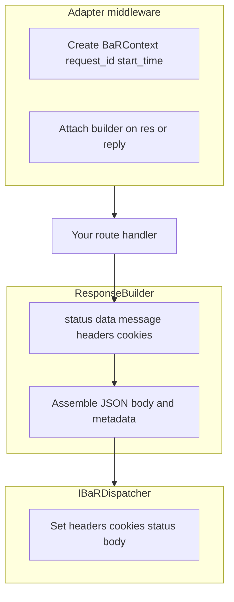

# BaR documentation

**BaR (Build a Response)** is a framework-agnostic TypeScript library for Node.js. It helps you build consistent, traceable JSON API responses for **Express**, **Fastify**, vanilla Node.js, or any stack where you implement a small **dispatcher** interface.

You chain status, message, data, headers, and cookies on a `ResponseBuilder`, then call `.build()` once. **Adapters** wire the builder into Express or Fastify and hand the result to a **dispatcher**, which sets HTTP status, headers, cookies, and the JSON body.

## How it fits together

**BaR builds the response; the dispatcher delivers it.** The same builder API works across frameworks.

## Guides

| Document | Who it's for |
|----------|----------------|
| [Getting started](./getting-started.md) | New users: install, exports, migration from 2.x, first Express route, TypeScript |
| [Adapters](./adapters.md) | Express and Fastify setup, options, vanilla Node, custom dispatchers |
| [Advanced chaining](./advanced-chaining.md) | Headers, cookies, metadata, pagination, `wrap()`, hooks, production error masking |
| [API reference](./api-reference.md) | Presets, builder methods, hooks, response schema, constants |

## Maintainers

- [Publishing](./PUBLISHING.md) — semantic-release, `NPM_TOKEN`, CI on `main`

## Quick links

- npm: [`@vorlaxen-labs/bar-js`](https://www.npmjs.com/package/@vorlaxen-labs/bar-js)
- Repository: [github.com/vorlaxen-labs/bar-js](https://github.com/vorlaxen-labs/bar-js)
